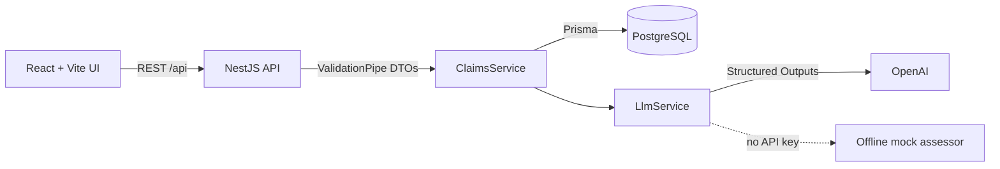

# Claims Intelligence Engine: Technical Proposal

## 1. Business process understanding

A cosmetic claim ("Reduces wrinkles by 20% in 4 weeks") is a regulated promise. In the EU, Regulation 1223/2009 and the common criteria of Regulation 655/2013 require every claim to be truthful and supported by adequate evidence. The workflow therefore passes through four roles, each acting as a gate:

| Step | Role | Decision | Status after |
|---|---|---|---|
| 1 | Business team | Proposes a product and its candidate claims | Pending |
| 2 | Claim manager | Is the claim applicable (fits product, market, regulation) and feasible (testable, affordable)? | Sent to Scientist / Rejected |
| 3 | R&I scientist | Runs the formulation test and records the result | Ready for Evaluation / Rejected |
| 4 | Evaluator | Attaches clinical study results; the AI checks they justify the claim; evaluator approves or rejects | Approved / Evaluation Rejected |

The AI does not replace the evaluator. It gives a fast, consistent first opinion (verdict, confidence, reasoning) and the human makes the final, accountable decision.

**Scope of this build.** The brief asks for the core feature at step 4: a claim and its evidence go to the LLM, and the verdict is saved and shown. This branch builds exactly that. Steps 1 to 3 are the surrounding workflow; the `main` branch contains a version that implements all four steps.

The key failure modes the AI must catch are mismatches between claim and evidence:
- **Endpoint**: self-assessed "smoother skin" does not prove measured wrinkle depth.
- **Magnitude**: a 14% reduction does not support "20%".
- **Timeframe**: a week-8 result does not support "in 4 weeks".
- **Design**: no control, tiny panel, or no statistical significance.

## 2. Research performed

- **Regulation.** EU 655/2013 common criteria (legal compliance, truthfulness, evidential support, honesty, fairness, informed decision-making) are encoded directly in the system prompt so the model reasons the way a claims reviewer would.
- **Substantiation methods.** Typical instrumental endpoints were reviewed: profilometry for wrinkles, corneometry for hydration, SPF in-vivo testing. The prompt asks the model to compare endpoint, magnitude, timeframe and design explicitly.
- **LLM output reliability.** OpenAI Structured Outputs (`response_format: json_schema`, `strict: true`) guarantees a parseable response with exactly `isJustified`, `confidenceScore` and `reasoning`. Temperature 0 gives repeatable verdicts.
- **Prompt injection.** Evidence is untrusted text, so it is wrapped in `<evidence>` tags and the system prompt tells the model to treat it as data only.
- **Stack choices.** Prisma was chosen over TypeORM for its typed client, declarative schema and first-class migrations. NestJS gives modules, dependency injection and DTO validation out of the box.

## 3. Technical architecture



**Data model.** `Claim 1—n Assessment`.

```prisma
model Claim {
  id             Int          @id @default(autoincrement())
  productName    String
  claimText      String       // as entered, for display
  normalizedText String       // trimmed, lowercased, single-spaced
  createdAt      DateTime     @default(now())
  assessments    Assessment[]

  @@unique([productName, normalizedText])
}

model Assessment {
  id              Int      @id @default(autoincrement())
  claimId         Int
  claim           Claim    @relation(fields: [claimId], references: [id], onDelete: Cascade)
  evidence        String   @db.Text
  isJustified     Boolean
  confidenceScore Float    // 0.0 - 1.0
  reasoning       String   @db.Text
  model           String   // LLM model id, or "mock"
  createdAt       DateTime @default(now())

  @@index([claimId, createdAt])
}
```

- **A claim is identified by product plus normalized wording.** Re-assessing the same claim with new evidence adds to its history instead of creating a duplicate. The product is part of the key because the same sentence can be true for one product and false for another. There is no fuzzy matching, because small wording changes matter legally ("reduces wrinkles" versus "reduces the appearance of wrinkles").
- **Assessments are append-only.** Each row stores the evidence, the verdict and the model that produced it, which gives an audit trail for regulated claims.

**Request flow for `POST /api/claims/assess`.** Body: `{ productName, claim, evidence }`.
1. DTO validation trims input and rejects bad requests: empty fields, evidence under 20 characters, unknown fields.
2. The LLM service calls OpenAI with Structured Outputs, temperature 0, a 30-second timeout and two retries. It runs first, so a failed call leaves nothing half-saved.
3. One database write links to the existing claim or creates it, then stores the assessment. If two identical requests race to create the same claim, the loser hits the unique constraint and retries.
4. The saved assessment is returned to the UI. OpenAI failures become a clean 502.

```ts
@Post('assess')
assess(@Body() dto: AssessClaimDto) {
  return this.claims.assess(dto);
}

// ClaimsService.assess
const verdict = await this.llm.assessClaim({ productName, claimText: claim, evidence });
return this.prisma.assessment.create({
  data: {
    evidence, ...verdict,
    claim: {
      connectOrCreate: {
        where:  { productName_normalizedText: { productName, normalizedText } },
        create: { productName, claimText: claim, normalizedText },
      },
    },
  },
});
```

**Why this design.**
- The LLM sits behind its own service, so the provider or model can change through config (`OPENAI_MODEL`) without touching business logic.
- The mock assessor lets the whole flow run in demos, tests and CI without a key or cost.
- The frontend talks to one typed API function (`src/api.ts`), and the Vite proxy avoids CORS in development.

## 4. Product roadmap

**Next (weeks)**
- Authentication and role-based access (SSO via Azure AD), so only evaluators can assess or approve.
- Upload study PDFs; extract text server-side and cite the passages the verdict relies on.
- Status-transition rules enforced in the backend as a state machine, with an audit log of who changed what.
- Automated tests: unit tests for the service, contract tests for the API, and a golden set of claim/evidence pairs to regression-test prompt changes.

**Later (months)**
- Retrieval over L'Oréal's historical studies and regulatory guidance (RAG), so the model compares against precedent.
- Multi-market rules: EU, US FTC/FDA, China NMPA. One claim, a verdict per market.
- Ensemble or second-model review for low-confidence verdicts, routed to a senior evaluator.
- Claim wording suggestions: "Evidence supports 15% in 4 weeks; consider rewording."
- Async processing with a queue for long documents, and streaming progress to the UI.

**Vision**
- A claims knowledge graph linking ingredients, formulas, studies and approved claims across brands.
- Predict claim feasibility before a study is commissioned, saving test budget.
- Continuous monitoring: re-check live claims automatically when regulations or new study data change.
- Evaluation dashboards tracking AI-versus-human agreement over time, to calibrate confidence scores.

## Appendix: React component (JSX)

A simplified, dependency-free version of the component. The full TypeScript version used in the app is `Loreal-frontend/src/components/ClaimAssessment.tsx`.

```jsx
import { useState } from "react";

export function ClaimAssessment() {
  const [productName, setProductName] = useState("");
  const [claim, setClaim] = useState("");
  const [evidence, setEvidence] = useState("");
  const [result, setResult] = useState(null);
  const [loading, setLoading] = useState(false);
  const [error, setError] = useState(null);

  async function handleSubmit(event) {
    event.preventDefault();
    setLoading(true);
    setError(null);
    try {
      const res = await fetch("/api/claims/assess", {
        method: "POST",
        headers: { "Content-Type": "application/json" },
        body: JSON.stringify({ productName, claim, evidence }),
      });
      const data = await res.json();
      if (!res.ok) throw new Error(data.message ?? "Assessment failed");
      setResult(data);
    } catch (err) {
      setError(err.message);
    } finally {
      setLoading(false);
    }
  }

  return (
    <section>
      <form onSubmit={handleSubmit}>
        <input value={productName} onChange={(e) => setProductName(e.target.value)} placeholder="Product" required />
        <input value={claim} onChange={(e) => setClaim(e.target.value)} placeholder="Claim" required />
        <textarea
          value={evidence}
          onChange={(e) => setEvidence(e.target.value)}
          placeholder="Paste clinical study results…"
          required
        />
        <button type="submit" disabled={loading || evidence.trim().length < 20}>
          {loading ? "Assessing…" : "Run AI Assessment"}
        </button>
      </form>

      {error && <p role="alert">{error}</p>}

      {result && (
        <div aria-live="polite">
          <p><strong>Justified:</strong> {result.isJustified ? "Yes" : "No"}</p>
          <p><strong>Confidence Score:</strong> {Math.round(result.confidenceScore * 100)}%</p>
          <p><strong>Reasoning:</strong> {result.reasoning}</p>
        </div>
      )}
    </section>
  );
}
```
